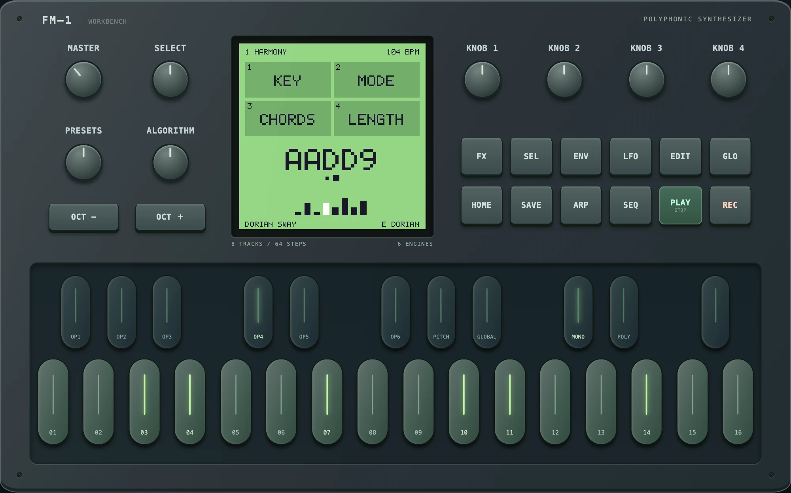
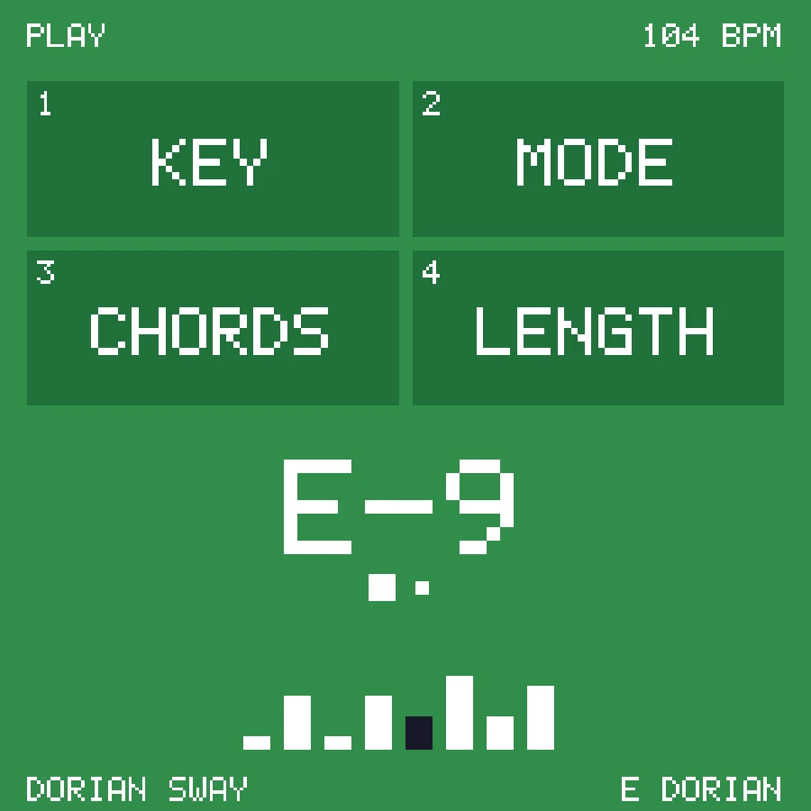
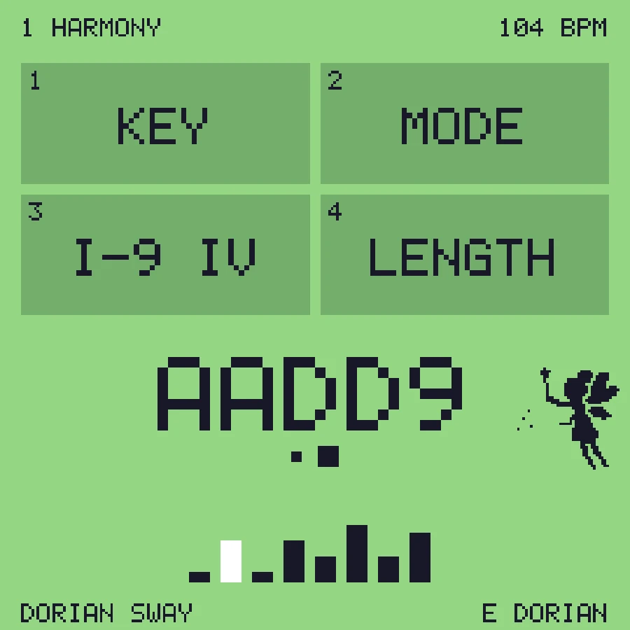
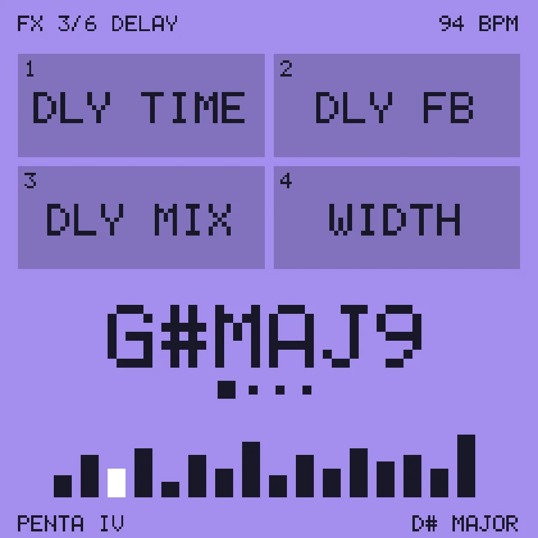

# ARPHONY – modal arpeggiator firmware for the M-VAVE FM-1

ARPHONY is a custom firmware for the **M-VAVE FM-1**. It plays repeating
single-note riffs over slowly moving modal chords: a riff on top, and below
it the harmony – a bass note plus up to two chord tones (at most three notes).

<p align="center"></p>

<p align="center">  </p>

<p align="center"><b><a href="https://subcity.at/flash/fm1-arphony/">Install in the browser</a></b> · <a href="https://subcity.at/demo/fm1-arphony/">Try the simulator</a> · <a href="https://subcity.at/fm1-arphony/">Downloads &amp; guide</a></p>

> **Beta – a hobby project.** ARPHONY runs on a real FM-1 (tested on one unit,
> October 2026), in the browser simulator and in native tests. Test reports
> from more FM-1 owners are very welcome. No support is promised.

Built on [M-VAVE FM1 Open](https://github.com/m-vave/fm1_open) (V14) and on
GLIDER (its voice engine, effects and panel code); the original README is kept
in [README.fm1-open.md](README.fm1-open.md). Sister projects:
[GLIDER](https://github.com/ttreu/fm1-glider) and [GLITCH](https://github.com/ttreu/fm1-glitch).

## What it does

- **Riff (ARP):** 17 riff shapes (rising chord, inner pedal, cascade, broken
  thirds, 12/8 triplets, sparse pings for the delay …) in 1/8, 1/8T, 1/16 or
  1/16T, with gate, swing, accent and MUTATE; TWIN adds an octave doubling
  or sparse high pings above. **SEQ** makes a new RANDOM riff from rules.
- **Never a copy:** every riff, built-in or random, is checked as it sounds
  against fingerprints of all 7-note figures in the reference recordings and
  changed if it would repeat one.
- **Harmony (HARM):** the bass and up to two chord tones in open voicings,
  held or pulsing (8ths, 16ths, syncopated, octaves, root-fifth …). The bass
  moves stepwise.
- **Chords:** 14 modal progressions (Dorian i9–IV, i–III–VII–IV, Aeolian
  bVI–bVII, Imaj9–IV over a pedal, Lydian IV–V, I–bIII, major/minor mixture
  over one bass note, a falling bass under a held chord …) or chords played on the keys (low half: own bass,
  high half: over the key's tonic as a pedal point).
- **LEAD harmony:** the riff keeps its shape and only moves to the nearest
  chord tones, so shared tones stay where they are while the bass moves.
  **PENTA** keeps it on the key's pentatonic over any bass.
- **Sound:** six ready riff sounds (LEAD; SINE LONG by default), two layers with their own oscillators, FM bell (ARP), sub (HARM),
  filters and envelopes; GLIDER's tape echo, ladder filter, ping-pong delay and
  shimmer reverb; 15 presets.
- **User presets:** 16 slots in the FM-1's Flash (SAVE).
- **RANDOM chords** (SEL + SEQ) in the current mode.
- **MIDI:** notes choose chords, clock sets the tempo, Start/Stop/Continue;
  MIDI OUT sends riff, bass and chords on channels 1–3.

The manual is [ARPHONY.md](ARPHONY.md); the musical analysis behind it
(in German) is [ANALYSE.md](ANALYSE.md).

## Build and test (macOS)

Toolchains next to the project folder (`../toolchains`: JieLi 2.5.3 under
Wine, WASI SDK 27), as for GLIDER:

```
python3 tools/build_web_mac.py      # browser simulator -> build/preview/index.html
node tests/arp_sim_test.mjs         # simulator test, writes demo WAVs to build/arp-test/
tests/run_native.sh                 # effect DSP tests
python3 tools/build_mac.py          # firmware + workbench page
```

Outputs: `build/dx7/generated/FM1-ARPHONY.fwsc` and
`build/official-web/FM1-ARPHONY.html` (workbench page with this firmware
and the original V15 recovery image, for Chrome/Edge).

## Install

**In the browser:** open [subcity.at/flash/fm1-arphony](https://subcity.at/flash/fm1-arphony/) in Chrome or
Edge, connect the FM-1 by USB and use *Device update* (coming from the stock firmware:
*Recovery & force update*). The page also holds the original M-VAVE V15 firmware to go back.
The same page is in the download on [subcity.at/fm1-arphony](https://subcity.at/fm1-arphony/), together with the source code.

**Before flashing:** back up your projects, voices and samples with the firmware that is
on the device now. ARPHONY does not use them; user presets (SAVE) live in the last 64 KB
of the sample area, so the first SAVE overwrites the end of the sample bank.

With FM1 Open firmware already on the device, macOS users can also flash from the
command line: `python3 tools/flash_fm1.py flash` (see ARPHONY.md).

## License

GPL-3.0-only with the FM1 linking exception ([LICENSE.md](LICENSE.md)). The
FM1 binary SDK, boot files and the V15 recovery image keep their own terms
([THIRD_PARTY.md](THIRD_PARTY.md)). Not an M-VAVE product; flashing is at
your own risk.
